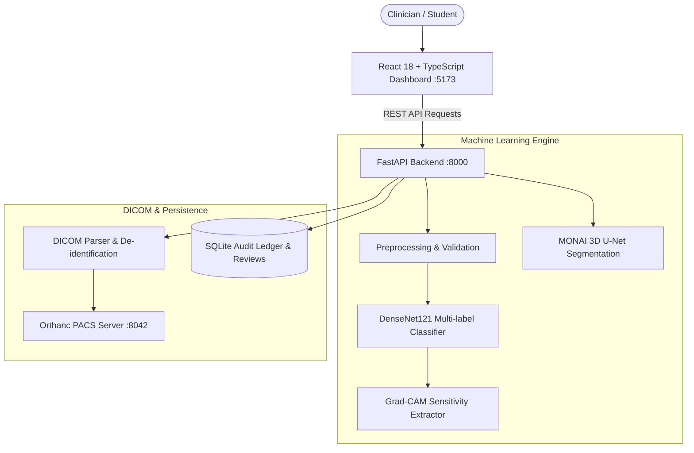

# AI-Assisted Medical Imaging and Diagnosis System

> ⚠️ **For education only — not for clinical use.**  
> This educational prototype demonstrates computer-aided triage, convolutional feature sensitivity visualization (Grad-CAM), 3D volumetric CT segmentation, PACS/DICOM interoperability, and human-in-the-loop audit logging. It is **NOT** approved by the FDA, CE, or any regulatory agency for real clinical diagnosis, screening, treatment planning, or patient care.

---

## 1. Project Implementation Status

| Feature / Subsystem | Status | Verification & Notes |
|---------------------|:------:|----------------------|
| **FastAPI REST API** | ✅ Complete | Health, Models, Classify, Grad-CAM, Segment, Studies, Reviews, Audit endpoints |
| **DenseNet121 Multi-Label Model** | ✅ Complete | 15 NIH ChestX-ray14 classes; PyTorch baseline with safe demo fallback |
| **Grad-CAM Visual Attribution** | ✅ Complete | Layer `features.denseblock4` hooked; dual heatmap + overlay with opacity slider |
| **MONAI 3D CT Segmentation Pipeline** | ✅ Complete | Full code in `ml/segmentation/pipeline.py`; training status marked pending |
| **PACS / DICOM Interoperability** | ✅ Complete | `dicom/parser.py` (photometric normalization, slope/intercept, de-id) + Orthanc client |
| **React + TypeScript Dashboard** | ✅ Complete | 9 full pages: Overview, New Scan, Studies, AI Analysis, Segmentation, Review Queue, Audit Log, Metrics, Settings |
| **Radiologist Adjudication & Audit** | ✅ Complete | Approve/Reject with mandatory note on rejection; immutable SQLite ledger |
| **Training & Evaluation Scripts** | ✅ Complete | `create_manifests.py` (patient-stratified), `train.py` (AMP, early stopping), `evaluate.py` |
| **Data Versioning (DVC)** | ✅ Complete | `.dvc/config`, `.dvcignore`, `data/splits.dvc` |
| **Docker & Orchestration** | ✅ Complete | `Dockerfile` for frontend & backend; `docker-compose.yml` with Orthanc PACS |
| **Automated Verification Suites** | ✅ Complete | `tests/` backend test suite (8 modules) + `frontend/src/test/` Vitest suites |
| **Presentation & Educational Docs** | ✅ Complete | 10-min presentation, live demo script, reflection template, model & dataset cards |

---

## 2. System Architecture



---

## 3. Directory Layout

```text
inter_project/
├── .dvc/                   # Data Version Control configuration & remotes
├── backend/                # FastAPI application
│   ├── app/
│   │   ├── ml/             # Preprocessing, DenseNet121, Grad-CAM, MONAI wrappers
│   │   ├── routers/        # Health, Models, Inference, Segmentation, Reviews, Studies
│   │   ├── config.py       # Pydantic Settings
│   │   ├── database.py     # SQLAlchemy async SQLite models (Review, AuditLog)
│   │   ├── dicom_service.py# DICOM/Orthanc service
│   │   └── main.py         # App factory, CORS, and lifespan
│   ├── requirements.txt    # Pinned production dependencies
│   ├── Dockerfile          # Backend container spec
│   └── run.py              # Local Uvicorn entry point
├── configs/                # Preprocessing, split, and hyperparameter YAMLs
├── data/                   # Dataset documentation, DVC pointers, and provenance
├── deployment/             # Orthanc DICOM server JSON configuration
├── dicom/                  # Safe DICOM parser, photometric normalization, Orthanc REST client
├── docs/                   # Architecture, 10-min presentation, demo script, model/dataset cards
├── frontend/               # React 18 + TypeScript + Vite SPA
│   ├── src/
│   │   ├── api/client.ts   # Axios client and TypeScript interfaces
│   │   ├── components/     # Layout, GradCAMViewer, PredictionPanel
│   │   ├── pages/          # 9 dashboard pages
│   │   └── test/           # Vitest and React Testing Library specs
│   ├── Dockerfile          # Multi-stage production container
│   └── nginx.conf          # Reverse proxy and SPA routing
├── ml/
│   ├── classification/     # DenseNet121 training & evaluation scripts
│   └── segmentation/       # MONAI 3D U-Net volumetric training pipeline
├── scripts/                # Patient-level stratified manifest generator
├── tests/                  # Pytest unit, API, Grad-CAM, DICOM, and error tests
├── docker-compose.yml      # Orchestration for Frontend, Backend, and Orthanc PACS
└── README.md
```

---

## 4. Quick Start Guide

### Option A: Local Native Execution

1. **Backend Setup:**
   ```bash
   cd backend
   pip install -r requirements.txt
   cp .env.example .env
   python run.py
   # API running at http://localhost:8000 (Swagger docs at /docs)
   ```

2. **Frontend Setup:**
   ```bash
   cd frontend
   npm install
   npm run dev
   # Dashboard running at http://localhost:5173
   ```

### Option B: Docker Compose

```bash
cp backend/.env.example backend/.env
docker compose up --build
```
- **Radiology Dashboard:** `http://localhost:5173`
- **FastAPI Engine & OpenAPI:** `http://localhost:8000/docs`
- **Orthanc DICOM PACS:** `http://localhost:8042` (Credentials: `orthanc` / `changeme_in_production`)

---

## 5. Running Automated Tests

```bash
# Backend pytest suite (8 test modules)
pytest tests/ -v

# Frontend component & router tests
cd frontend
npm test
```

---

## 6. Clinical & Algorithmic Disclaimers

1. **Not a Clinical Device:** This software is an educational prototype. It must not be deployed for clinical triage or diagnostic decisions.
2. **Label Quality:** NIH ChestX-ray14 labels are extracted from text reports using NLP and contain inherent label noise.
3. **Attribution Map Limits:** Grad-CAM illustrates convolutional activation sensitivity, not clinical causality or anatomical boundaries.
4. **Data Leakage Mitigation:** Manifest generation (`scripts/create_manifests.py`) enforces strict patient-level separation across splits.
